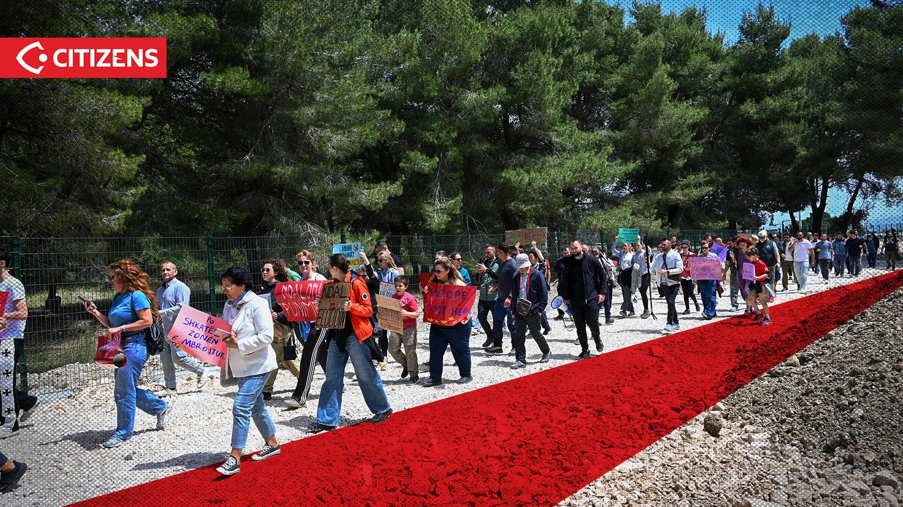
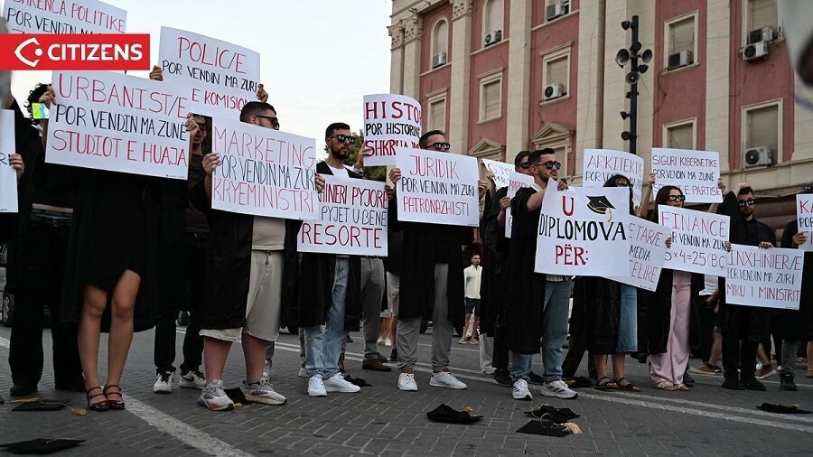

> **Context note:** This section describes the Flamingo Revolution’s published account and positions. Illyrian Brains documents them for context without endorsing every claim.

# Why did the protests begin?

The protests began in opposition to development affecting the **Vjosë–Nartë protected coastal landscape**. The movement says its concerns later widened to include public accountability, corruption allegations, education and healthcare, youth emigration, economic pressure, democratic representation and the rule of law.

!!! info "Source and perspective"
    This page explains **the movement's stated reasons**. It does not establish the truth of every allegation against institutions, developers or individuals. For a neutral briefing, attribute claims to their authors and seek official responses.

## In brief

| Date | Milestone in the movement's published chronology |
|---|---|
| 16 May | Protest near construction site at Akërni, Pishë Poro–Narta |
| 23 May | Gathering at Narta Lagoon |
| 30 May | Incident involving private security at Zvërnec |
| 31 May | March in Tirana |
| 4 June onward | Demonstrations spread to other cities and diaspora communities |
| 13–15 October | Student-led protests and reported confrontations in Tirana |

Dates and participation figures should not be treated as independently verified merely because they appear on the movement's site.

<figure class="content-figure">
  
  <figcaption>16 May, Akërni. Photo: Citizens.al, via Flamingo Revolution movement archive.</figcaption>
</figure>
<figure class="content-figure">
  
  <figcaption>13–15 October, Tirana. Photo: Citizens.al, via Flamingo Revolution movement archive.</figcaption>
</figure>

Read next: [Who is involved?](who.md) · [What do they want?](demands.md) · [Where did it happen?](where.md) · [How can people respond?](how.md)

[About this project and its documentation approach](../editorial-policy.md)

Sources: [movement chronology](https://www.flamingorevolution.eu/protestat/) · [independent source directory](../directory.md)
