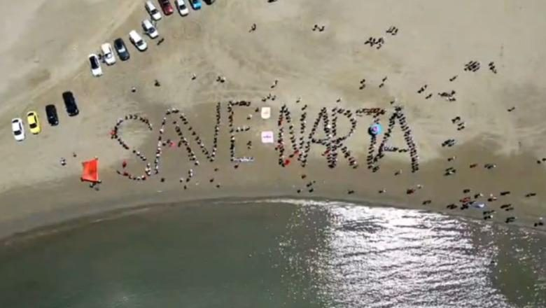
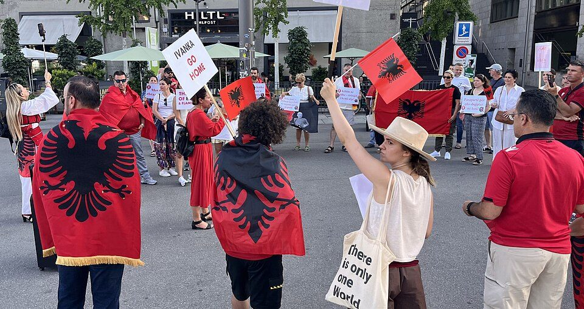

---
hide:
  - navigation
---

# The Flamingo Revolution and civic rights in Albania

This resource began in response to the **Flamingo Revolution**, a civic protest movement that first formed around development in the Vjosë–Nartë protected coastal landscape. As the protests grew and raised wider concerns about rights and public accountability, this guide was created to help people understand the situation and communicate responsibly.

It helps readers contact media, public representatives and civil-society organizations about reported rights concerns during protests in Albania. It does not speak for the Flamingo Revolution or ADCN, endorse a political party, or prejudge responsibility for any incident.

[**Read the ADCN evidence brief (PDF) →**](assets/ADCN_Tirana_13_October_2026_Evidence_Brief.pdf){ .md-button .md-button--primary }

## What can I do?

<a class="step-card" href="countries/">01<strong>Choose your country →</strong>Find the appropriate outreach guide for one of 21 countries.</a>
<a class="step-card" href="languages/en/">02<strong>Choose an email →</strong>Select the Media, Institution or Representative tab in your language.</a>

[**Start here: choose your country →**](countries/index.md) · [Latest evidence briefing →](briefs/tirana-2026-10-13-15-urgent.md)

## Gallery

<figure class="content-figure">
  
  <figcaption>16 May, Akërni. Photo: Citizens.al, via Flamingo Revolution movement archive.</figcaption>
</figure>
<figure class="content-figure">
  
  <figcaption>13–15 October, Tirana. Photo: Citizens.al, via Flamingo Revolution movement archive.</figcaption>
</figure>
<figure class="content-figure">
  
  <figcaption>An aerial formation reading "Save Narta" on the beach at Narta Lagoon. Photo: Flamingo Revolution movement archive.</figcaption>
</figure>
<figure class="content-figure">
  
  <figcaption>Albanian diaspora communities demonstrate abroad. Photo: Flamingo Revolution movement archive.</figcaption>
</figure>
<figure class="content-figure">
  
  <figcaption>International audiences are part of this conversation too. Photo: Citizens.al, via Flamingo Revolution movement archive.</figcaption>
</figure>

[**See the full evidence gallery →**](evidence-gallery.md)

## Before sharing

Check the date, source and context of each claim. Distinguish reporting, allegations and verified findings. Protect people pictured or named in footage. Request accountability for violence by **any** actor, while recognizing the rights of peaceful participants, journalists, bystanders and detainees.

For context and documentation, see [Background](background/index.md), [Gallery](evidence-gallery.md), and [Sources](directory.md).
