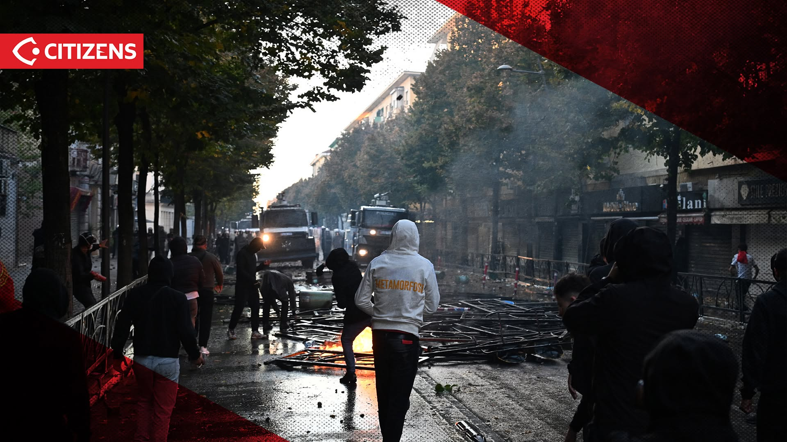
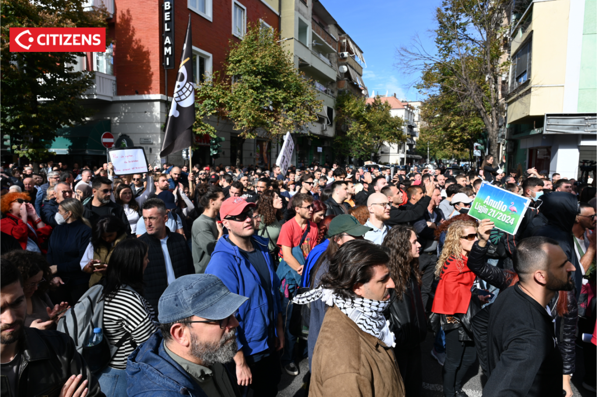
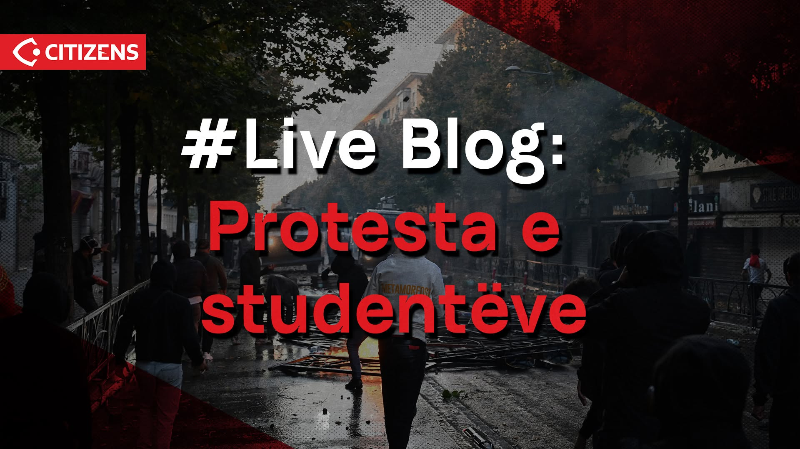

---
hide:
  - toc
---

!!! warning "Before sending"
    - [ ] Choose the correct recipient tab.
    - [ ] Personalize the subject, greeting and request.
    - [ ] Verify the latest reporting and links.
    - [ ] Send in your own name without implying organizational authorization.

# Flamingo Protests in Albania — English awareness emails

=== "Media"

    **Subject:** Flamingo Protests in Albania: reported police abuses during Tirana student demonstrations

    To whom it may concern,

    I am asking your newsroom to urgently examine reported human-rights abuses during the student-led demonstrations that began in Tirana on 13 October 2026 and have since spread. The protests involve students, including high school pupils, and the allegations deserve wider public attention.

    These demonstrations form part of more than 140 days of Flamingo protests in Albania. According to the [movement's published protest chronology](https://www.flamingorevolution.eu/protestat/), the protests began over development affecting the protected Vjosë–Nartë coastal landscape and broadened to concerns about public accountability, corruption allegations, education and healthcare, youth emigration, economic pressure, democratic representation and the rule of law.

    Key reported figures include:

    - **1,067 arrests and 388 criminal proceedings:** reported by Reuters and attributed to the Albanian authorities at the time of publication.
    - **310 injured through 19 October:** 191 police officers, 88 protesters and 31 bystanders, reported by *El País* citing Ministry of Health figures.
    - **214 detained people met during earlier monitoring:** the Ombudsman's preliminary record, as cited in the Res Publica letter, noted visible signs of violence or mistreatment allegations for 26 people and reports concerning about 12 minors allegedly held in isolation.
    - **32 reported police-violence cases:** catalogued in the Res Publica open-letter annex covering 13–17 October; these are reported cases, not final legal findings.
    - **124 evidence items reviewed:** described in the lawyers' cover letter to Amnesty International, including 31 newly submitted log entries covering 18–20 October; the underlying confidential log is not public in this repository.

    These figures have different periods, populations and definitions. They overlap and should not be added together as a single total.

    Source-linked reporting raises concerns about:

    - **Crowd-control weapons:** police use of tear gas, water cannon, batons, irritant spray and, according to international reporting on 17 October, rubber bullets against protesters and bystanders.
    - **Physical force and restraint:** potentially excessive force, including people reportedly held on the ground.
    - **Serious injury:** a hospital interviewee alleged that police caused a serious leg injury.
    - **Detention safeguards:** the Ombudsman documented missing rights-information forms, incomplete detention registers and allegations that personal phones were searched without appropriate authorization.
    - **Treatment of minors:** reports include questioning without guardians or psychologists, alleged isolation and possible exposure to force or detention.
    - **Freedom of the press:** assaults, threats, injuries, obstruction and forced removal affecting journalists and media workers.

    These are attributed reports and allegations requiring independent verification, not established legal findings. Some participants reportedly threw stones and lit fires; that does not justify the use of force against people who did not. As the Albanian Helsinki Committee said on 13 October, the acts of individuals cannot make an entire assembly violent, and police force must remain lawful, necessary and proportionate.

    Please assign a reporter, seek responses from the Albanian authorities and affected people, and press for preservation of police video, deployment orders and medical records alongside an independent inquiry into the serious leg-injury case—especially while covering the possible treatment of minors and interference with journalists. I would appreciate knowing whether and when your newsroom plans to cover this. The attached brief provides sources and verification questions.

    Selected international reporting, newest first:

    - El País, 22 October — reporting from Tirana on the continuing student protests, police–protester violence and the government's offer of dialogue: <https://elpais.com/internacional/2026-10-22/la-violencia-se-instala-entre-policia-y-manifestantes-en-albania-es-legitima-cuando-el-estado-te-ignora-y-agrede.html>
    - OCCRP / SHTEG, 20 October — the protests' second week, reported mass arrests and the Ombudsman's detention findings: <https://www.occrp.org/en/news/albanian-pm-offers-dialogue-amid-crackdown-on-violent-protests>
    - Associated Press, 20 October — eighth consecutive day of clashes, tear gas and water cannon: <https://apnews.com/article/76658d03cf1d00656c27ceabb7151b0a>
    - Reuters, 18 October — arrests, criminal proceedings and the government's response: <https://www.reuters.com/world/albanian-pm-says-mass-protests-threat-eu-membership-not-government-2026-10-18/>
    - Al Jazeera, 18 October — sixth consecutive day of unrest and continuing demonstrations in Tirana: <https://www.aljazeera.com/news/2026/10/18/chaos-in-tirana-demonstrators-determined-to-not-give-up-so-easily>
    - Le Monde, 17 October — police-violence allegations and civic response: <https://www.lemonde.fr/en/international/article/2026/10/17/in-albania-the-flamingo-revolution-radicalizes-in-response-to-the-prime-minister-s-contempt-and-indifference_6758697_4.html>

    Primary and local documentation for specific allegations:

    - Albanian Ombudsman, 20 October — preliminary monitoring findings on detention conditions and the treatment of minors: <https://www.avokatipopullit.gov.al/sq/articles-layout-1/home/news/commissioner-ahmet-preni-communication-with-the-media-regarding-findings-from-the-monitoring-of-the-october-19-2026-protest-1382/>
    - Euronews Albania — hospital interview concerning the alleged serious leg injury: <https://euronews.al/protestuesi-i-lenduar-tek-trauma-policet-me-keputen-kemben-video/>
    - Association of Journalists of Albania — documented incidents affecting journalists and media workers: <https://agsh.al/2026/10/14/alb-eng-agsh-dy-dite-protestash-ne-tirane-te-pakten-10-incidente-ndaj-gazetareve-dhe-punonjesve-te-medias-dhuna-dhe-pengimi-i-raportimit-jane-te-papranueshme/>
    - ADCN — evidence base: <https://albaniandiasporacivicnetwork.com/sq/violence-appeal/>
    - Hajde n’Shesh — video collection documenting reported police violence: <https://hajdenshesh.com/dhuna>

    Kind regards,

    - [Flamingo Revolution](https://www.flamingorevolution.eu/) — protest documentation and civic projects.
    - [Flamingo Revolution Diaspora](https://flamingo-berlin.github.io/) — diaspora updates and outreach.
    - [Albanian Diaspora Civic Network](https://albaniandiasporacivicnetwork.com/) — research and evidence-based civic work.
    - [Illyrian Brains Network](https://illyrianbrains.org/) — a global network of Albanian professionals.

=== "International institution"

    !!! warning "Who is best placed to send this?"
        Suggested senders, in priority order:

        - **The Flamingo communities**
        - **Civic organisations**
        - **Professionals in the networks**
        - **A diaspora member**

        Use the strongest genuine connection and describe it accurately.

    **Subject:** Flamingo Protests in Albania: urgent alert on reported rights abuses

    To whom it may concern,

    I am writing to alert your institution to serious reported human-rights concerns during student-led demonstrations that began in Tirana on 13 October 2026 and have since spread. Students, journalists, bystanders and detainees may be affected, and high school participation raises particular child-protection concerns.

    These demonstrations form part of more than 140 days of Flamingo protests in Albania. According to the [movement's published protest chronology](https://www.flamingorevolution.eu/protestat/), the protests began over development affecting the protected Vjosë–Nartë coastal landscape and broadened to concerns about public accountability, corruption allegations, education and healthcare, youth emigration, economic pressure, democratic representation and the rule of law.

    Key reported figures include:

    - **1,067 arrests and 388 criminal proceedings:** reported by Reuters and attributed to the Albanian authorities at the time of publication.
    - **310 injured through 19 October:** 191 police officers, 88 protesters and 31 bystanders, reported by *El País* citing Ministry of Health figures.
    - **214 detained people met during earlier monitoring:** the Ombudsman's preliminary record, as cited in the Res Publica letter, noted visible signs of violence or mistreatment allegations for 26 people and reports concerning about 12 minors allegedly held in isolation.
    - **32 reported police-violence cases:** catalogued in the Res Publica open-letter annex covering 13–17 October; these are reported cases, not final legal findings.
    - **124 evidence items reviewed:** described in the lawyers' cover letter to Amnesty International, including 31 newly submitted log entries covering 18–20 October; the underlying confidential log is not public in this repository.

    These figures have different periods, populations and definitions. They overlap and should not be added together as a single total.

    Source-linked reporting raises concerns about:

    - **Crowd-control weapons:** police use of tear gas, water cannon, batons, irritant spray and, according to international reporting on 17 October, rubber bullets against protesters and bystanders.
    - **Physical force and restraint:** potentially excessive force, including people reportedly held on the ground.
    - **Serious injury:** a hospital interviewee alleged that police caused a serious leg injury.
    - **Detention safeguards:** the Ombudsman documented missing rights-information forms, incomplete detention registers and allegations that personal phones were searched without appropriate authorization.
    - **Treatment of minors:** reports include questioning without guardians or psychologists, alleged isolation and possible exposure to force or detention.
    - **Freedom of the press:** assaults, threats, injuries, obstruction and forced removal affecting journalists and media workers.

    These are attributed reports and allegations requiring independent verification, not established legal findings. Some participants reportedly threw stones and lit fires; that does not justify the use of force against people who did not. As the Albanian Helsinki Committee said on 13 October, the acts of individuals cannot make an entire assembly violent, and police force must remain lawful, necessary and proportionate.

    I would be grateful if your institution could:

    - Place this situation on your urgent monitoring agenda and contact the appropriate Albanian authorities now.
    - Seek preservation of police video, deployment orders and medical records relevant to the reported injuries and detentions.
    - Press for an independent, person-specific inquiry into the serious leg-injury case and any allegations of excessive force.
    - Clarify what action you can take through bilateral or multilateral channels, including the OSCE and the Council of Europe where relevant.

    I would be grateful for a reply explaining what your institution can do and when I might expect a response. I have attached the ADCN evidence brief, which links directly to the reporting and original posts below.

    Selected international reporting, newest first:

    - El País, 22 October — reporting from Tirana on the continuing student protests, police–protester violence and the government's offer of dialogue: <https://elpais.com/internacional/2026-10-22/la-violencia-se-instala-entre-policia-y-manifestantes-en-albania-es-legitima-cuando-el-estado-te-ignora-y-agrede.html>
    - OCCRP / SHTEG, 20 October — the protests' second week, reported mass arrests and the Ombudsman's detention findings: <https://www.occrp.org/en/news/albanian-pm-offers-dialogue-amid-crackdown-on-violent-protests>
    - Associated Press, 20 October — eighth consecutive day of clashes, tear gas and water cannon: <https://apnews.com/article/76658d03cf1d00656c27ceabb7151b0a>
    - Reuters, 18 October — arrests, criminal proceedings and the government's response: <https://www.reuters.com/world/albanian-pm-says-mass-protests-threat-eu-membership-not-government-2026-10-18/>
    - Al Jazeera, 18 October — sixth consecutive day of unrest and continuing demonstrations in Tirana: <https://www.aljazeera.com/news/2026/10/18/chaos-in-tirana-demonstrators-determined-to-not-give-up-so-easily>
    - Le Monde, 17 October — police-violence allegations and civic response: <https://www.lemonde.fr/en/international/article/2026/10/17/in-albania-the-flamingo-revolution-radicalizes-in-response-to-the-prime-minister-s-contempt-and-indifference_6758697_4.html>

    Primary and local documentation for specific allegations:

    - Albanian Ombudsman, 20 October — preliminary monitoring findings on detention conditions and the treatment of minors: <https://www.avokatipopullit.gov.al/sq/articles-layout-1/home/news/commissioner-ahmet-preni-communication-with-the-media-regarding-findings-from-the-monitoring-of-the-october-19-2026-protest-1382/>
    - Euronews Albania — hospital interview concerning the alleged serious leg injury: <https://euronews.al/protestuesi-i-lenduar-tek-trauma-policet-me-keputen-kemben-video/>
    - Association of Journalists of Albania — documented incidents affecting journalists and media workers: <https://agsh.al/2026/10/14/alb-eng-agsh-dy-dite-protestash-ne-tirane-te-pakten-10-incidente-ndaj-gazetareve-dhe-punonjesve-te-medias-dhuna-dhe-pengimi-i-raportimit-jane-te-papranueshme/>
    - ADCN — evidence base: <https://albaniandiasporacivicnetwork.com/sq/violence-appeal/>
    - Hajde n’Shesh — video collection documenting reported police violence: <https://hajdenshesh.com/dhuna>

    Kind regards,

    - [Flamingo Revolution](https://www.flamingorevolution.eu/) — protest documentation and civic projects.
    - [Flamingo Revolution Diaspora](https://flamingo-berlin.github.io/) — diaspora updates and outreach.
    - [Albanian Diaspora Civic Network](https://albaniandiasporacivicnetwork.com/) — research and evidence-based civic work.
    - [Illyrian Brains Network](https://illyrianbrains.org/) — a global network of Albanian professionals.

=== "International representative"

    !!! warning "Who is best placed to send this?"
        Suggested senders, in priority order:

        - **The Flamingo communities**
        - **Civic organisations**
        - **Professionals in the networks**
        - **A diaspora member**

        Use the strongest genuine connection and describe it accurately.

    **Subject:** Flamingo Protests in Albania: please raise reported human-rights abuses

    To whom it may concern,

    I am writing as [a constituent / a member of the Albanian diaspora / a concerned resident] to ask you to draw urgent attention to reported human-rights abuses during student-led demonstrations that began in Tirana on 13 October 2026 and have since spread. Watching the reports has been frightening, and I want everyone protesting, passing by or reporting the news to come home safely.

    These demonstrations form part of more than 140 days of Flamingo protests in Albania. According to the [movement's published protest chronology](https://www.flamingorevolution.eu/protestat/), the protests began over development affecting the protected Vjosë–Nartë coastal landscape and broadened to concerns about public accountability, corruption allegations, education and healthcare, youth emigration, economic pressure, democratic representation and the rule of law.

    Key reported figures include:

    - **1,067 arrests and 388 criminal proceedings:** reported by Reuters and attributed to the Albanian authorities at the time of publication.
    - **310 injured through 19 October:** 191 police officers, 88 protesters and 31 bystanders, reported by *El País* citing Ministry of Health figures.
    - **214 detained people met during earlier monitoring:** the Ombudsman's preliminary record, as cited in the Res Publica letter, noted visible signs of violence or mistreatment allegations for 26 people and reports concerning about 12 minors allegedly held in isolation.
    - **32 reported police-violence cases:** catalogued in the Res Publica open-letter annex covering 13–17 October; these are reported cases, not final legal findings.
    - **124 evidence items reviewed:** described in the lawyers' cover letter to Amnesty International, including 31 newly submitted log entries covering 18–20 October; the underlying confidential log is not public in this repository.

    These figures have different periods, populations and definitions. They overlap and should not be added together as a single total.

    Source-linked reporting raises concerns about:

    - **Crowd-control weapons:** police use of tear gas, water cannon, batons, irritant spray and, according to international reporting on 17 October, rubber bullets against protesters and bystanders.
    - **Physical force and restraint:** potentially excessive force, including people reportedly held on the ground.
    - **Serious injury:** a hospital interviewee alleged that police caused a serious leg injury.
    - **Detention safeguards:** the Ombudsman documented missing rights-information forms, incomplete detention registers and allegations that personal phones were searched without appropriate authorization.
    - **Treatment of minors:** reports include questioning without guardians or psychologists, alleged isolation and possible exposure to force or detention.
    - **Freedom of the press:** assaults, threats, injuries, obstruction and forced removal affecting journalists and media workers.

    These are attributed reports and allegations requiring independent verification, not established legal findings. Some participants reportedly threw stones and lit fires; that does not justify the use of force against people who did not. As the Albanian Helsinki Committee said on 13 October, the acts of individuals cannot make an entire assembly violent, and police force must remain lawful, necessary and proportionate.

    I would be grateful if you could:

    - Raise the safety of demonstrators, bystanders, journalists and detainees with the Albanian authorities now.
    - Seek preservation of police video, deployment orders and medical records relevant to the reported injuries and detentions.
    - Press for an independent, person-specific inquiry into the serious leg-injury case and any allegations of excessive force.
    - Tell me what your government will do through its bilateral relations with Albania and through the OSCE or the Council of Europe.

    I would be grateful for a reply explaining what you can do and when I might expect a response. I have attached the ADCN evidence brief, which links directly to the reporting and original posts below.

    Selected international reporting, newest first:

    - El País, 22 October — reporting from Tirana on the continuing student protests, police–protester violence and the government's offer of dialogue: <https://elpais.com/internacional/2026-10-22/la-violencia-se-instala-entre-policia-y-manifestantes-en-albania-es-legitima-cuando-el-estado-te-ignora-y-agrede.html>
    - OCCRP / SHTEG, 20 October — the protests' second week, reported mass arrests and the Ombudsman's detention findings: <https://www.occrp.org/en/news/albanian-pm-offers-dialogue-amid-crackdown-on-violent-protests>
    - Associated Press, 20 October — eighth consecutive day of clashes, tear gas and water cannon: <https://apnews.com/article/76658d03cf1d00656c27ceabb7151b0a>
    - Reuters, 18 October — arrests, criminal proceedings and the government's response: <https://www.reuters.com/world/albanian-pm-says-mass-protests-threat-eu-membership-not-government-2026-10-18/>
    - Al Jazeera, 18 October — sixth consecutive day of unrest and continuing demonstrations in Tirana: <https://www.aljazeera.com/news/2026/10/18/chaos-in-tirana-demonstrators-determined-to-not-give-up-so-easily>
    - Le Monde, 17 October — police-violence allegations and civic response: <https://www.lemonde.fr/en/international/article/2026/10/17/in-albania-the-flamingo-revolution-radicalizes-in-response-to-the-prime-minister-s-contempt-and-indifference_6758697_4.html>

    Primary and local documentation for specific allegations:

    - Albanian Ombudsman, 20 October — preliminary monitoring findings on detention conditions and the treatment of minors: <https://www.avokatipopullit.gov.al/sq/articles-layout-1/home/news/commissioner-ahmet-preni-communication-with-the-media-regarding-findings-from-the-monitoring-of-the-october-19-2026-protest-1382/>
    - Euronews Albania — hospital interview concerning the alleged serious leg injury: <https://euronews.al/protestuesi-i-lenduar-tek-trauma-policet-me-keputen-kemben-video/>
    - Association of Journalists of Albania — documented incidents affecting journalists and media workers: <https://agsh.al/2026/10/14/alb-eng-agsh-dy-dite-protestash-ne-tirane-te-pakten-10-incidente-ndaj-gazetareve-dhe-punonjesve-te-medias-dhuna-dhe-pengimi-i-raportimit-jane-te-papranueshme/>
    - ADCN — evidence base: <https://albaniandiasporacivicnetwork.com/sq/violence-appeal/>
    - Hajde n’Shesh — video collection documenting reported police violence: <https://hajdenshesh.com/dhuna>

    Kind regards,

    - [Flamingo Revolution](https://www.flamingorevolution.eu/) — protest documentation and civic projects.
    - [Flamingo Revolution Diaspora](https://flamingo-berlin.github.io/) — diaspora updates and outreach.
    - [Albanian Diaspora Civic Network](https://albaniandiasporacivicnetwork.com/) — research and evidence-based civic work.
    - [Illyrian Brains Network](https://illyrianbrains.org/) — a global network of Albanian professionals.

## Optional image attachments and Flamingo resources

Download only the images relevant to your message, keep the supplied credit, and link to the original publication. Do not imply that a photograph proves conduct outside what is visible in the frame. Image rights remain with the publisher; these files are provided for attributed outreach use and should be removed from an email if reuse permission is uncertain.

  <article>
    
    <strong>13 October · Tirana street scene</strong>
    Credit: Citizens.al. Context includes police vehicles, smoke, people and street damage; it does not establish responsibility for any specific act.
    
<a href="../assets/images/evidence/citizens-13oct-tear-gas.jpg" download>Download image</a> · <a href="https://citizens.al/2026/10/13/studentet-rizgjojne-protesten-policia-pergjigjet-me-dhune/" target="_blank" rel="noopener noreferrer">Original report ↗</a>

  </article>
  <article>
    
    <strong>14 October · Student boycott and march</strong>
    Credit: Citizens.al. Use with the publisher's description and do not infer institutional endorsement from participation.
    
<a href="../assets/images/evidence/citizens-14oct-boycott.png" download>Download image</a> · <a href="https://citizens.al/2026/10/14/protesta-e-studenteve-nis-me-bojkot/" target="_blank" rel="noopener noreferrer">Original report ↗</a>

  </article>
  <article>
    
    <strong>15 October · Live protest coverage</strong>
    Credit: Citizens.al. Verify the original caption and context before attaching or describing the image.
    
<a href="../assets/images/evidence/citizens-15oct-live.jpg" download>Download image</a> · <a href="https://citizens.al/2026/10/15/protesta-e-studenteve-ore-pas-ore/" target="_blank" rel="noopener noreferrer">Original report ↗</a>

  </article>

[Protest chronology and photographs ↗](https://www.flamingorevolution.eu/protestat/){ .md-button }
[Flamingo Dossier ↗](https://www.flamingorevolution.eu/dosjet/){ .md-button }
[Flamingo protest map ↗](https://www.flamingorevolution.eu/harta/){ .md-button }

!!! note "Suggested attachment caption"
    Attached photographs are credited to Citizens.al and are shared with links to the original reporting. They provide visual context only; captions distinguish what is visible from allegations that require independent verification. The Flamingo links above provide the movement's protest chronology and photographs, public-source dossier, and protest map.

## Translations

The same three emails are available in [Albanian](../languages/sq.md), [Czech](../languages/cs.md), [Danish](../languages/da.md), [Dutch](../languages/nl.md), [Finnish](../languages/fi.md), [French](../languages/fr.md), [German](../languages/de.md), [Italian](../languages/it.md), [Norwegian](../languages/no.md), [Polish](../languages/pl.md), [Portuguese](../languages/pt.md), [Spanish](../languages/es.md) and [Swedish](../languages/sv.md).

## Credits and acknowledgements

This outreach material draws on documentation, civic organizing and public information contributed by [ADCN](https://albaniandiasporacivicnetwork.com/), [Flamingo Revolution](https://www.flamingorevolution.eu/), [Flamingo Berlin](https://flamingo-berlin.github.io/) and other Flamingo groups across the diaspora, the Albanian Helsinki Committee, local reporters on the ground, journalists and independent volunteers. Acknowledgement does not imply authorship, authorization or endorsement of this template by every named group.

Sources, open questions and verification standards for every claim above are collected in [Background → Sources and verification](../background/sources.md).
