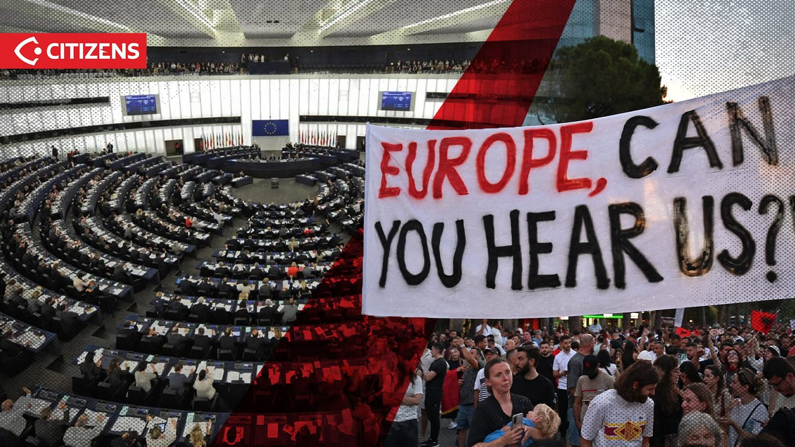

# How to communicate responsibly about civic rights

<figure class="content-figure">
  
  <figcaption>International audiences are part of this conversation too. Photo: Citizens.al, via Flamingo Revolution movement archive.</figcaption>
</figure>

## A short citizen guide

1. **Collect facts.** Use reputable reporting, original documents and human-rights sources. Note the date, location, attribution and uncertainties. Do not spread rumours.
2. **Make one clear request.** Ask for dialogue, protection of peaceful assembly, safety of everyone involved and independent investigation of alleged violations.
3. **Write to the media.** Share three sourced facts, one clear request and an interview contact only with that person’s permission.
4. **Write to representatives.** Contact your local representative or the appropriate foreign-affairs committee. Ask for a question to the responsible ministry or diplomatic engagement within their mandate.
5. **Work with others.** Coordinate with professionals, students, lawyers or human-rights groups, while avoiding duplicate or misleading mass messages.
6. **Follow up respectfully.** Thank respondents and record the response privately.

**Rules:** Facts, not hate · No party campaigning · No misinformation · Respect everyone.

## Ready to send

[Choose one of three email templates](messages/index.md) · [Choose country](countries/index.md) · [Translated emails](languages/en.md) · [Evidence briefing](briefs/tirana-2026-10-13-15-urgent.md)

**Before sending:** Write in your own name and capacity. Do not claim to represent Illyrian Brains, ADCN or the Flamingo Revolution unless authorized. Adapt the request to the recipient’s actual mandate and cite dated sources.
